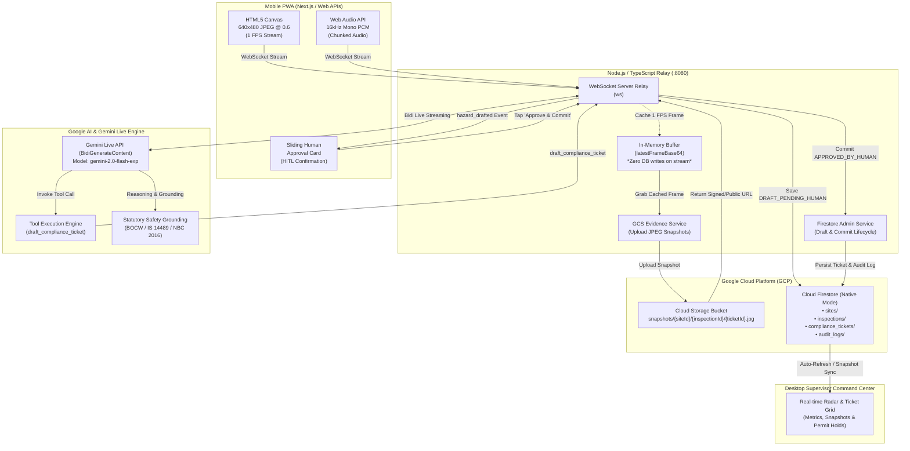

# KavachLive (कवच लाइव) 🛡️
### Enterprise Multimodal Field Safety & Statutory Compliance Agent for Indian Job Sites

[](https://nextjs.org/)
[](https://nodejs.org/)
[](https://ai.google.dev/)
[](https://cloud.google.com/firestore)
[](https://www.typescriptlang.org/)
[](https://tailwindcss.com/)

---

## 1. Executive Summary & Problem Statement

On Indian construction, infrastructure, and industrial sites, safety supervisors and field engineers work in hazardous, hands-busy outdoor environments. Manual form-filling on mobile devices is tedious and routinely skipped, resulting in unrecorded statutory non-compliances (**Building and Other Construction Workers (BOCW) Act 1996/1998**, **IS 14489:2018**, **National Building Code (NBC) 2016**), which lead to avoidable industrial accidents and regulatory shutdowns.

**KavachLive** transforms this workflow into an effortless, real-time multimodal safety walk:
- The site supervisor points their mobile camera at active operations and speaks naturally in **conversational Hinglish**.
- **Gemini Live API** analyzes incoming 1 FPS video frames and 16kHz audio in real time, detecting hazards (e.g., unchained gas cylinders, workers at height without harnesses, unshielded hot work).
- The agent verbally alerts the supervisor in Hinglish within ~1 second and drafts a structured compliance violation ticket citing the exact Indian statutory clause.
- A **Sliding Human-in-the-Loop Approval Card** pops up on the mobile screen. The ticket is **never** auto-committed without the supervisor tapping **"Approve & Commit"**.
- Approved tickets and high-resolution evidence snapshots stream immediately to Cloud Firestore and Google Cloud Storage, updating the **Desktop Supervisor Command Center** in real time.

---

## 2. Core Architecture & System Flow



---

## 3. Key Architectural Pillars

### I. 1 FPS Bandwidth & Battery Optimization
Streaming full video at 30 FPS over Indian cellular networks drains mobile battery and incurs massive data costs. KavachLive captures video on an HTML5 canvas at `640x480` JPEG (`0.6` quality) and streams strictly at **1 frame per second**, slashing mobile bandwidth by over **90%** while preserving sharp resolution for hazard inspection.

### II. Zero-DB In-Memory Buffering
The backend never writes incoming frames or audio chunks to Firestore every second. Instead, it caches the latest video frame in server RAM (`latestFrameBase64`). Only when Gemini spots a hazard and triggers `draft_compliance_ticket` does the server upload that single frame to Cloud Storage and save metadata in Firestore.

### III. Strict Human-in-the-Loop (HITL) Governance
Autonomous AI must not halt multi-crore infrastructure projects on false positives. The backend enforces a strict state machine:
```text
[Hazard Detected] ➔ DRAFT_PENDING_HUMAN ➔ [Supervisor Reviews Card] ➔ APPROVED_BY_HUMAN (Committed)
                                                                    ➔ REJECTED (Audited)
```
No ticket is marked active or resolved in Cloud Firestore without an explicit `approve_ticket` WebSocket event originating from physical human confirmation.

### IV. Indian Statutory Grounding
Every drafted ticket extracts specific regulatory clauses:
- **BOCW Central Rules (1998)**: Rule 35 (Cylinders), Rule 38 (Electrical), Rule 42 (Scaffolding).
- **IS 14489:2018**: Code of Practice on Occupational Health & Safety Audit.
- **National Building Code (NBC) 2016 Part 7**: Construction Management, Practices & Safety.

---

## 4. Cloud Firestore Schema (4 Core Collections)

### 1. `sites/{siteId}`
Stores physical job sites and assigned contractors.
```typescript
interface Site {
  id: string;               // e.g., "SITE-KNP-01"
  name: string;             // e.g., "Metro Phase-2 Pier 14, Kanpur"
  code: string;             // e.g., "SITE-KNP-01"
  projectManager: string;   // e.g., "Er. Vikram Singh"
  contractors: string[];    // e.g., ["Ramesh Infra Pvt Ltd", "Shakti Electricals"]
  riskScore: number;        // 0-100 (Dynamic safety score)
  createdAt: string;        // ISO 8601
}
```

### 2. `inspections/{inspectionId}`
Tracks active walk sessions initiated from `/inspect`.
```typescript
interface Inspection {
  id: string;
  siteId: string;
  siteName: string;
  supervisorName: string;   // e.g., "Er. Arjun Mehta"
  language: "hinglish" | "hindi" | "english";
  status: "ACTIVE" | "COMPLETED";
  startedAt: string;
  endedAt?: string;
  ticketsDraftedCount: number;
}
```

### 3. `compliance_tickets/{ticketId}` *(The Primary Violation Record)*
```typescript
interface ComplianceTicket {
  id: string;
  inspectionId: string;
  siteId: string;
  siteName: string;
  hazardTitle: string;        // e.g., "Unsecured Oxygen Cylinder Near Hot-Work"
  hazardDescription: string;  // Detailed observation from video + voice
  sopClause: string;          // e.g., "BOCW Central Rule 35 / IS 14489 Sec 4.2"
  sopSourceDoc: string;       // e.g., "BOCW_Central_Rules_1998.pdf"
  severity: "LOW" | "MEDIUM" | "HIGH" | "CRITICAL";
  permitHold: boolean;        // True if severity === "CRITICAL" (Work Stop Required)
  assignedContractor: string; // e.g., "Ramesh Infra Pvt Ltd"
  aiConfidence: number;       // e.g., 0.94
  snapshotUrl: string;        // Cloud Storage URL (Never base64 in Firestore)
  voiceTranscript: string;
  approvalStatus: "DRAFT_PENDING_HUMAN" | "APPROVED_BY_HUMAN" | "REJECTED";
  approvedBy?: string;
  approvedAt?: string;
  resolutionStatus: "OPEN" | "RESOLVED";
  createdAt: string;
}
```

### 4. `audit_logs/{logId}`
Immutable audit trail for compliance verification.
```typescript
interface AuditLog {
  id: string;
  ticketId: string;
  siteId: string;
  action: "TICKET_DRAFTED_BY_AI" | "TICKET_APPROVED_BY_HUMAN" | "PERMIT_HOLD_APPROVED" | "TICKET_REJECTED";
  actor: string;              // "GeminiLive-Agent" or Supervisor Name
  timestamp: string;
  metadata?: Record<string, any>;
}
```

---

## 5. Technology Stack

- **Frontend (Mobile PWA & Dashboard):**
  - Next.js 14 (App Router, React 18, TypeScript)
  - Tailwind CSS & Lucide Icons
  - HTML5 Canvas 2D API (`drawImage`, `toDataURL` JPEG compression)
  - Web Audio API (`AudioContext`, `ScriptProcessorNode`, linear 16-bit PCM streaming)
  - Native WebSockets (`ws://`)
- **Backend (Relay Server):**
  - Node.js & TypeScript (ESM)
  - Express.js (REST endpoints for sites & tickets)
  - WebSocket Server (`ws`)
  - Google Gen AI SDK (`@google/genai` v3.6+)
  - Firebase Admin SDK v14 (`firebase-admin/app`, `firebase-admin/firestore`, `firebase-admin/storage`)
- **Cloud Infrastructure (Google Cloud Platform):**
  - Cloud Firestore (Native Mode, `asia-south1` Mumbai)
  - Google Cloud Storage (Bucket: `snapshots/{siteId}/{inspectionId}/{ticketId}.jpg`)
  - Gemini Live Multimodal Streaming API (`gemini-2.0-flash-exp`)

---

## 6. Local Setup & Installation

### Prerequisites
- **Node.js**: v18 or higher (v20+ recommended)
- **Google Cloud Platform Account** with Cloud Firestore enabled in **Native Mode**.
- **Gemini API Key** from [Google AI Studio](https://aistudio.google.com/apikey).

---

### Step 1: Clone Repository
```bash
git clone https://github.com/TanmayChaurasia24/kavachlive.git
cd kavachlive
```

---

### Step 2: Setup Google Cloud Credentials

1. Open [Google Cloud Console - IAM & Service Accounts](https://console.cloud.google.com/iam-admin/serviceaccounts).
2. Create or select a Service Account with **Cloud Datastore User** (or **Editor**) permissions.
3. Generate and download a **JSON private key**.
4. Move and rename this file to:
   ```bash
   backend/serviceAccountKey.json
   ```
   *(Note: This file is already excluded in `.gitignore` and must never be committed).*

---

### Step 3: Configure Backend Environment Variables

In `backend/.env`:
```env
PORT=8080
GOOGLE_APPLICATION_CREDENTIALS="./serviceAccountKey.json"
GEMINI_API_KEY="AIzaSyYourGeneratedGeminiApiKeyHere"
GCS_BUCKET_NAME="kavach-live-evidence"
```

---

### Step 4: Install Dependencies & Build Backend

```bash
cd backend
npm install
npm run build
```

---

### Step 5: Seed the Firestore Database

Run the database seed script to initialize test job sites (e.g. `SITE-KNP-01`):
```bash
cd backend
node dist/seed.js
```
*Expected Output:*
```text
Seeding initial sites into Cloud Firestore...
✅ Successfully seeded site [SITE-KNP-01]: "Metro Phase-2 Pier 14, Kanpur"
Verified Firestore Read: { name: 'Metro Phase-2 Pier 14, Kanpur', ... }
```

---

### Step 6: Install Frontend Dependencies & Build

```bash
cd ../frontend
npm install
npm run build
```

---

## 7. Running the Application

### 1. Start Backend Server (Terminal 1)
```bash
cd backend
npm start
# or for development: npm run dev
```
- Express API: `http://localhost:8080`
- WebSocket Server: `ws://localhost:8080`
- Health check: `http://localhost:8080/health`

### 2. Start Frontend Server (Terminal 2)
```bash
cd frontend
npm run dev
```
- Open browser at: **`http://localhost:3000`**

---

## 8. How to Test the Application

### Test Scenario A: Mobile Field Inspection (`/inspect`)

1. Open **`http://localhost:3000/inspect`** on your browser (or on your mobile phone on the same Wi-Fi network).
2. **Setup Session:**
   - Select Site: **"Metro Phase-2 Pier 14, Kanpur (SITE-KNP-01)"**
   - Lead Supervisor: **"Er. Arjun Mehta"**
   - Voice Language: **"Hinglish"**
3. Click **"Start Live Inspection"**:
   - Allow camera and microphone permissions when prompted.
   - The viewfinder will activate, displaying the live stream with status badges:
     - `● LIVE 1 FPS`
     - `Bidi Audio 16kHz`
     - A dynamic audio visualizer bar reacting to your voice.
4. **Speak & Point:**
   - Point your camera towards a work area or image depicting hot work, gas cylinders, or scaffolding.
   - Speak in Hinglish:
     > *"Supervisor sir, yahan welding chal rahi hai, dekho sab surakshit hai kya?"*
5. **Observe AI Response:**
   - Within ~1–2 seconds, Gemini will respond verbally in conversational Hinglish through your speakers.
   - Real-time subtitles will appear at the bottom of the video feed.
6. **Human Approval Card:**
   - A sliding card will appear from the bottom showing:
     - Violation Title: *"Unsecured Compressed Gas Cylinders / Missing Fire Protection"*
     - Severity Badge: `CRITICAL: WORK STOP REQUIRED` or `HIGH`
     - Statutory Citation: `BOCW Central Rule 35 / IS 14489`
     - Snapshot: The exact video frame captured by the camera.
7. **Action:**
   - Tap **"Approve & Commit"**: A green confirmation toast indicates the ticket has been written to Cloud Firestore.
   - Tap **"End Inspection Session"** when done.

---

### Test Scenario B: Supervisor Command Center (`/dashboard`)

1. Open **`http://localhost:3000/dashboard`** on your desktop browser.
2. Observe the KPI summary cards:
   - **Total Violations Spotted**
   - **Critical Permit Holds** (highlighted in red)
   - **Pending Human Approval** (highlighted in amber)
   - **Approved by Supervisor** (highlighted in emerald)
3. In the live compliance table:
   - View newly approved tickets with exact timestamps, contractor assignments, and BOCW clause citations.
   - Click any thumbnail in the **Snapshot** column to view the high-resolution evidence photo in a modal.
   - Filter incidents dynamically using the site dropdown menu.

---

## 9. Ideal & Expected System Behavior

| Feature / Action | Ideal Behavior | Latency / Metric |
| :--- | :--- | :--- |
| **Video Ingestion** | 1 frame per second captured on HTML5 canvas at `640x480` JPEG (`0.6` quality). | Bandwidth $\approx$ 30–50 KB/sec |
| **Audio Ingestion** | 16kHz mono linear PCM streaming directly over WebSocket. | Ultra-low packet latency (<100ms) |
| **Verbal Response** | Natural, authoritative Hinglish voice (`Aoede` voice preset) addressing the engineer. | $\sim 1.0 - 1.5$ seconds |
| **Evidence Snapshot** | Uploaded to GCS only when a hazard is identified; saved under clean path `snapshots/{siteId}/{inspectionId}/{ticketId}.jpg`. | 1 single storage write per violation |
| **Approval Card** | Slides up smoothly; displays exact clause citation and photo snapshot. | Appears immediately upon tool call |
| **Database Commit** | **Zero auto-commit:** Ticket stays `DRAFT_PENDING_HUMAN` until human taps "Approve". Once approved, status changes to `APPROVED_BY_HUMAN` and writes to `audit_logs`. | Immediate Firestore write on approval |
| **Command Center** | Automatically updates with new violations, permit holds, and contractor assignments. | Auto-refreshes every 6 seconds |

---

## 10. Repository Structure

```text
kavachlive/
├── backend/
│   ├── src/
│   │   ├── services/
│   │   │   ├── database.ts        # Firestore CRUD, session management & audit logging
│   │   │   └── storage.ts         # Cloud Storage snapshot evidence uploader
│   │   ├── geminiLive.ts          # Gemini Live API bidirectional session & tool declaration
│   │   ├── index.ts               # Express API & WebSocket relay server
│   │   ├── seed.ts                # Firestore test site seeder (SITE-KNP-01)
│   │   ├── type.ts                # TypeScript schemas for Firestore & WebSockets
│   │   └── types.ts               # Re-export barrel
│   ├── dist/                      # Compiled JavaScript output
│   ├── package.json
│   ├── tsconfig.json
│   └── serviceAccountKey.json     # (Ignored in Git) GCP Service Account credentials
│
├── frontend/
│   ├── app/
│   │   ├── dashboard/             # Desktop Command Center (Live Ticket Table)
│   │   │   └── page.tsx
│   │   ├── inspect/               # Mobile Field Inspector view (Camera + Mic + Card)
│   │   │   └── page.tsx
│   │   ├── globals.css            # Tailwind styles & keyframe animations
│   │   ├── layout.tsx             # Root layout with responsive viewport
│   │   └── page.tsx               # Home landing portal
│   ├── components/
│   │   └── ApprovalCard.tsx       # Sliding Human-in-the-Loop Approval Card
│   ├── hooks/
│   │   └── useInspectionStream.ts # Canvas 1 FPS, 16kHz PCM audio & WebSocket hook
│   ├── types/
│   │   └── inspection.ts          # Shared client TypeScript types
│   ├── next.config.js
│   ├── package.json
│   ├── postcss.config.js
│   ├── tailwind.config.ts
│   └── tsconfig.json
│
├── README.md                      # Comprehensive project documentation
└── .gitignore                     # Repository-wide ignore rules
```

---

## 11. Security, Compliance & License

- **Private Credentials**: Service account keys and `.env` files are strictly excluded from version control.
- **Role-Based Access Control**: Field supervisors require manual approval before violations commit to enterprise storage.
- **Audit Logging**: Every ticket creation, approval, and rejection records an immutable audit trail in `audit_logs`.
- **License**: Built for enterprise safety and statutory compliance under the ISC License.
